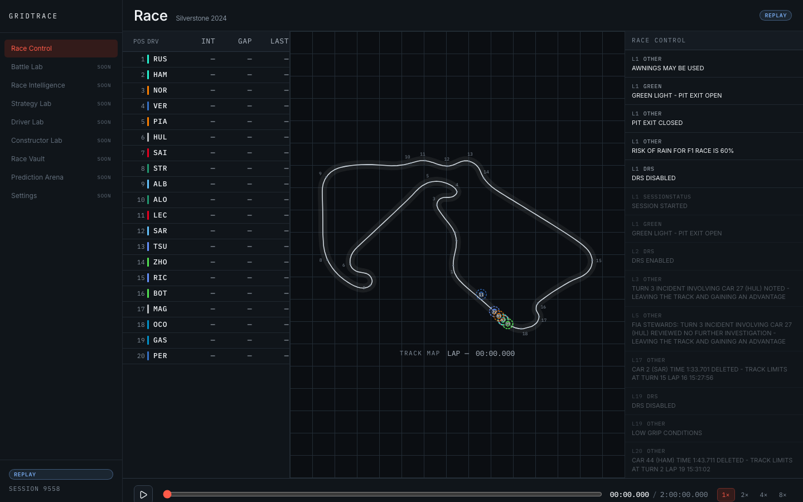
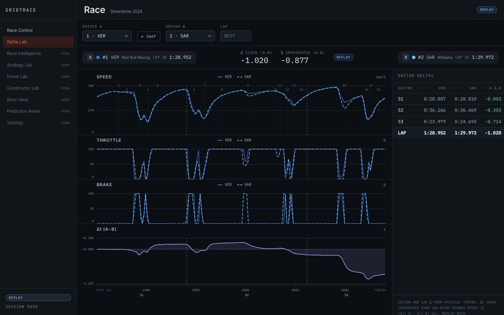
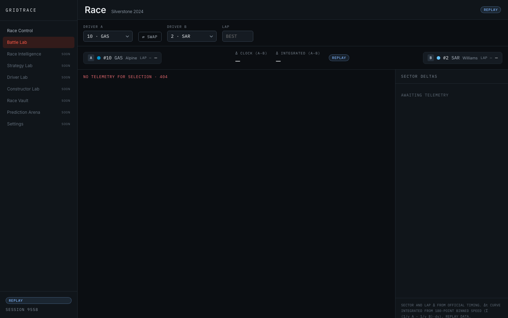
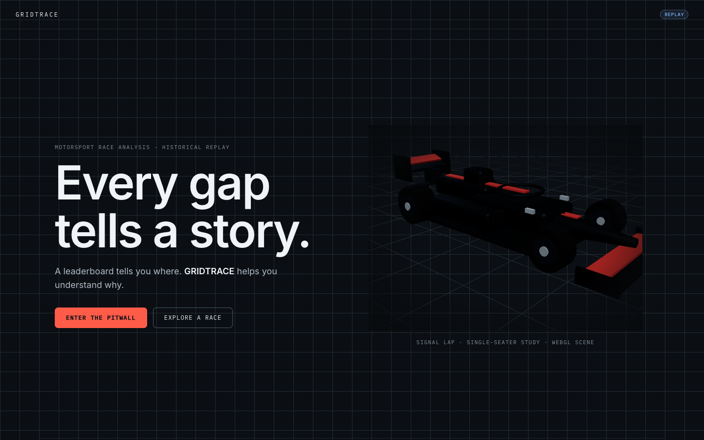
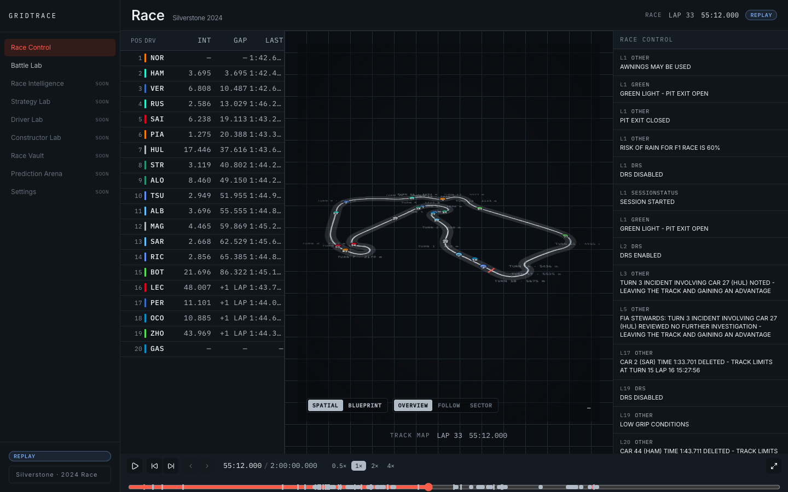
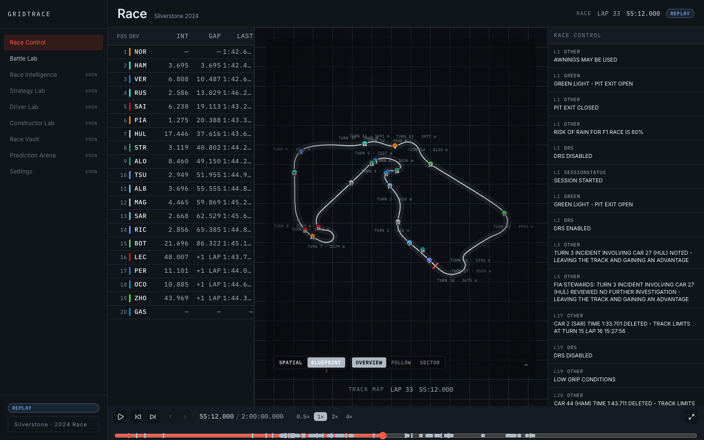
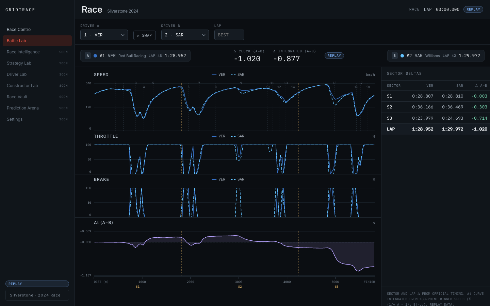

# GRIDTRACE — Papaya edition

Personal fork of the Echelon team's [f1infographics](https://github.com/EchelonSystemsArchitecture/f1infographics/tree/ashwinwork) (`ashwinwork` branch) with a rebuilt, team-themeable landing page. Papaya (McLaren colours) is the first theme; more teams plug in via `frontend/src/theme/teams.ts`.

**Landing sections:** preloader → beam hero (real 3D car, cursor-driven key light) → block-wipe thesis + marquee → chase-cam replay section (tyre light trails and road rendered in the same scene as the car) → NPR studies (toon / blueprint / rim light) → isometric garage with exploded power unit → pitwall modules → footer. A rotating tyre in the bottom-right tracks the current section.

**Run:** `cd frontend && npm install && npm run dev` → http://localhost:5173 (`?skipintro` skips the preloader, `/lab` is a model test bench).

**Assets:** see [CREDITS.md](CREDITS.md). The car model is CC BY-NC 4.0 — non-commercial use only.

---

# GRIDTRACE — Every gap tells a story

Interactive motorsport race-analysis platform. Historical F1 race replay with live-style race control, position/gap timelines, and distance-aligned telemetry battle lab.

> **Live (production):** **https://gridtrace.vercel.app**
> Landing at `/` · App at `/app` · API under `/api/*` (all `REPLAY` data).
> Deployed from `ashwinwork` — this alias always serves the latest production build. If you see an old UI, hard-refresh (Cmd/Ctrl+Shift+R) or check the direct deployment URL in `vercel ls`.

**Branch:** `ashwinwork` (app development; `main` remains the static GitHub Pages site)
**Repo:** `git@github.com:EchelonSystemsArchitecture/f1infographics.git` (SSH, user `ashvyagni`)

## Status

| Build | Date | What shipped | Docs |
|-------|------|--------------|------|
| 0 | 2026-10-18 | Repo init, full docs skeleton, data-source verification (OpenF1 + Jolpica + MultiViewer), Python env working | [BUILD_LOG](docs/BUILD_LOG.md#build-0) |
| 1 | 2026-10-18 | Vite+React+TS scaffold, design tokens, zustand shared race clock, FastAPI skeleton + Pydantic contracts, test harnesses (pytest + Vitest) | [BUILD_LOG](docs/BUILD_LOG.md#build-1) |
| 2 | 2026-10-19 | Ingestion pipeline (fetch + normalize) for flagship Silverstone 2024, real-data API endpoints (sessions/drivers/state@t/race-control), state reconstruction, 12-test data QA suite, master design + landing directives | [BUILD_LOG](docs/BUILD_LOG.md#build-2) |
| 3 | 2026-10-19 | Full `--gt-*` tokens + self-hosted fonts, SIGNAL LAP landing at `/`, `/app` shell, Race Control board (110 real events), clock-driven timing tower (20 drivers, real gaps/tyres), replay controls (play/pause/speed/scrubber) | [BUILD_LOG](docs/BUILD_LOG.md#build-3) |
| 4 | 2026-10-19 | Public deploy on Vercel: FastAPI serverless API + SPA (`app.frontend()` CDN promotion, ADR-008); live at **https://gridtrace.vercel.app** | [BUILD_LOG](docs/BUILD_LOG.md#build-4) |
| 5 | 2026-10-19 | Track map (G1.7): per-driver location ingest (20 × 33,896 rows) → committed `locations.json`, `GET /circuit`, `markers`+`marker_mode` on state@t, SVG TrackMap with moving cars in Race Control (orientation +84.25°/flip-y, ADR-009); 22 backend tests | [BUILD_LOG](docs/BUILD_LOG.md#build-5) |
| 6 | 2026-10-19 | Battle Lab (G2.1): per-driver `car_data` ingest → distance-binned `telemetry.json` (ADR-011 units fix) → `GET /session/{key}/telemetry` (36 tests) → Battle Lab route — SVG speed/throttle/brake + Δt charts on a shared distance axis, sector-delta table, lap selector, honest 404 for missing telemetry (screenshots below) | [BUILD_LOG](docs/BUILD_LOG.md#build-6) |
| 7 | 2026-10-19 | Art-direction resurrection starts: reconciliation layer (`ART_DIRECTION.md`, `UI_UX_SPECIFICATION.md`, rewritten `DESIGN_SYSTEM.md`, ADR-012) + procedural 3D single-seater asset (`SingleSeater3D.tsx`, three/R3F/drei) | [BUILD_LOG](docs/BUILD_LOG.md#build-7) |
| 8 | 2026-10-19 | Cinematic 3D landing hero: `--gt-scene-*` tokens + `--gt-scene` motion, lazy `HeroScene.tsx` (Three.js fog, key/rim lights, grid floor, 0.5s entrance), WebGL fallback to original SVG Signal Lap, scene caption | [BUILD_LOG](docs/BUILD_LOG.md#build-8) |
| 9 | 2026-10-19 | Spatial circuit stage (CSS-perspective SPATIAL/BLUEPRINT, FOLLOW/OVERVIEW camera, driver markers + turn labels, custom pitwall crosshair) + Race Ribbon timeline (event pins by semantic token + shape, expandable axis, speed/transport controls) replacing flat TrackMap + ReplayControls | [BUILD_LOG](docs/BUILD_LOG.md#build-9) |
| 10 | 2026-10-19 | 4-region app shell (rail 220px / session header / stage + timing table / ribbon spanning bottom) per master §10.3, deliberate session-selection screen (§10.2, never a marketing gate), selectable timing-tower rows + clickable editorial race-control events seek the shared clock, focus-visible rings on every new interactive surface (§20 microinteractions) | [BUILD_LOG](docs/BUILD_LOG.md#build-10) |
| 11 | 2026-10-19 | Visual acceptance gate (master §27): headless-Chrome (SwiftShader) 1440×900 capture of 6 screens + SPATIAL circuit-stage contrast fix (thicker track + lighter vignette); all 18 gate items inspected — **PASS with refinements** | [BUILD_LOG](docs/BUILD_LOG.md#build-11) |
| 12 | 2026-10-19 | **§28 final implementation report** (resurrection Task H): `docs/FINAL_REPORT.md` — what works, tests actually run, honest limitations, how to run; ADR-013 closes the art-direction task graph (Tasks A–H all complete) | [FINAL_REPORT](docs/FINAL_REPORT.md) |

**Live:** https://gridtrace.vercel.app — landing at `/`, app at `/app`, API under `/api/*` (all `REPLAY` data). Deep links use a Vercel SPA fallback rewrite; `/api/*` stays on the FastAPI function (ADR-010).

## Data mode honesty

This build (and near-term builds) use **HISTORICAL REPLAY** data from OpenF1's free post-session API (2023+). No live timing. UI will label every view with its data mode: `LIVE` / `REPLAY` / `ESTIMATE` / `SIMULATION` / `UNAVAILABLE`. We never fabricate numbers.

## Quickstart (as of Build 5)

Production is already deployed (https://gridtrace.vercel.app); the steps below are for local development only.

```bash
# Backend (Python 3.14 + uv)
cd backend
uv venv --python 3.14 .venv
uv pip install --python .venv/bin/python -r requirements.txt

# Ingest flagship session 9558 (2024 British GP) — session-level ~16s;
# per-driver heavy endpoints (car_data/location) are pulled by the same fetch
# (location ≈ 82 MB cache → 3.0 MB normalized locations.json)
.venv/bin/python -m app.ingest.fetch --session 9558
.venv/bin/python -m app.ingest.normalize

# Run API
.venv/bin/uvicorn app.main:app --reload --port 8000

# Tests (run from backend/ or repo root)
.venv/bin/pytest -q

# Frontend
cd frontend && npm install
npm run dev      # http://localhost:5173, /api proxies to :8000
npm test -- --run
npm run build && npm run lint
```

### API surface (Build 5; same on production)

| Endpoint | Returns |
|----------|---------|
| `GET /api/health` | `{"status":"ok"}` |
| `GET /api/sessions` | Normalized session list (flagship 9558) |
| `GET /api/session/9558/drivers` | 20 drivers with team colours |
| `GET /api/session/9558/state?t=SECONDS` | Position/gap/tyre state reconstructed at t, plus `markers` (20 cars) + `marker_mode` |
| `GET /api/session/9558/race-control` | 110 race-control events (REPLAY) |
| `GET /api/session/9558/circuit` | Closed Silverstone path `{x:[], y:[]}`, 18 corners, pit-loss constants |

## Docs map (read in this order)

1. [AGENTS.md](AGENTS.md) — rules for every agent working in this repo
2. [TASKS.md](TASKS.md) — task graph (P0 critical path first)
3. [docs/PRODUCT_SPEC.md](docs/PRODUCT_SPEC.md) — what we're building and why
4. [docs/ARCHITECTURE.md](docs/ARCHITECTURE.md) — system design, shared race clock
5. [docs/DATA_SOURCES_AND_PROVENANCE.md](docs/DATA_SOURCES_AND_PROVENANCE.md) — every API we tested, what worked, field schemas, research log
6. [docs/ART_DIRECTION_MASTER.md](docs/ART_DIRECTION_MASTER.md) — **governing** art-direction source (CARBON/CHALK/SIGNAL + DEPTH, tokens, modules, task graph §26, gate §27)
7. [docs/ART_DIRECTION.md](docs/ART_DIRECTION.md) — reconciliation layer: source hierarchy, supersessions, provenance, task-graph → workstream map
8. [docs/LANDING_PAGE_DIRECTIVE.md](docs/LANDING_PAGE_DIRECTIVE.md) — landing page experience spec (THE SIGNAL LAP; §2/§6/§9 superseded — see ART_DIRECTION.md)
9. [docs/DESIGN_SYSTEM.md](docs/DESIGN_SYSTEM.md) — Digital Pitwall design system: full `--gt-*` token tables, type, components, motion, accessibility
10. [docs/UI_UX_SPECIFICATION.md](docs/UI_UX_SPECIFICATION.md) — 4-region layout, Circuit Stage, crosshair, Race Ribbon, components, states, breakpoints
11. [docs/BUILD_LOG.md](docs/BUILD_LOG.md) — how each build was done, step by step
12. [docs/DECISIONS.md](docs/DECISIONS.md) — ADRs (ADR-012 permits Three.js/R3F for hero + Circuit Stage)
13. [docs/FINAL_REPORT.md](docs/FINAL_REPORT.md) — **§28 final implementation report** (what works, tests run, honest limitations)
14. [docs/SETUP.md](docs/SETUP.md) — dev environment setup
15. [docs/TESTING_AND_QA.md](docs/TESTING_AND_QA.md) — test strategy

## Screenshots

**Race Control board with track map** (Build 5 — Silverstone outline, 18 corner labels, 20 driver markers at the grid t=0, `REPLAY` status row):



**Battle Lab** (Build 6 — two drivers on one distance axis, speed/throttle/brake + Δt charts, sector-delta table, rail; `REPLAY` badge):



**Battle Lab honest 404** (Build 6 — Gasly #10 is in the session but has no `car_data`; the app says so instead of faking a trace):



**Art-direction gate (Build 11 — master §27, 1440×900)** — landing hero, spatial + blueprint circuit stage, editorial race control (mid-race), session picker, Battle Lab:






Full 6-shot set in `docs/screenshots/build10-gate/`. More shots land as modules ship; see `docs/screenshots/`.

## License / data attribution

OpenF1 data © OpenF1 / their providers, free for historical use. Jolpica mirrors Ergast. MultiViewer circuit geometry for corner markers. All usage within each provider's terms — see provenance doc.
